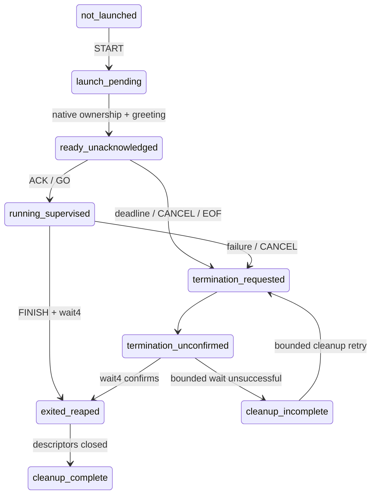

Atomic native publication update: see [ATOMIC_NATIVE_PUBLICATION.md](ATOMIC_NATIVE_PUBLICATION.md). Developer validation passed; independent acceptance required. Historical evidence follows.

Terminal-completion update: see [TERMINAL_COMPLETION.md](TERMINAL_COMPLETION.md). Current developer validation: 162 tests, 23 native scenarios, 13 crash/IPC cases. Independent acceptance required. Prior evidence follows unchanged.

Publication Gate V3 update: see [PUBLICATION_GATE_V3.md](PUBLICATION_GATE_V3.md) for the current commit/cancellation contract and validation. Earlier results below are retained historical evidence. Production conversion remains unauthorized.

# Isolated native supervisor candidate

Current revision: **publication gate V2**, awaiting independent Astra High re-audit. See [PUBLICATION_GATE_V2.md](PUBLICATION_GATE_V2.md), [code diff](publication-gate-v2.diff), and [final validation](publication-gate-v2-release/summary.json). The complete preceding 291-file candidate is preserved in `audit-history/pre-publication-gate-v2/`. Earlier results and performance records remain historical evidence.

This is a synthetic-only development candidate awaiting independent Astra High audit. It does not replace V3, the integration candidate, or the numerical prototype. No production execution command is provided. The 16 MiB synthetic guards, 120 CPU-second limit, and 180-second supervisor session deadline intentionally prevent using this package for a full production conversion.

## Architecture and entry point

The documented entry point is the **childless bootstrap**, which authenticates executable bytes and **execs** the native supervisor. Do not start the supervisor from `candidate.py`, import the bootstrap as an application library, or reintroduce a coordinator `Popen` launch.

```text
operator / dedicated native test harness
  -> python3 -I -B bootstrap.py [synthetic mode]
       -> exec authenticated, sealed supervisor descriptor (same process/PID)
            |-- owns Python coordinator (fixed inherited control pipes)
            `-- owns numerical worker (PID, pidfd, pipes, wait status)
```

The supervisor is a single-threaded native program. Signal handlers only set flags; they cannot raise Python exceptions or unwind C acquisition. `pipe2` fills preallocated native arrays. `fork` results, descriptor transfers, and `pidfd_open` results enter native ownership records before cancellation is processed. A Python exception between a system call and Python assignment cannot erase those records. Bootstrap failures terminate the childless process, so kernel teardown closes even descriptors that Python never recorded.

The coordinator performs all model inventory, safetensors I/O, source hashing, numerical orchestration, configuration copying, staging, receipts and publication. The supervisor relays bounded bytes and owns processes; it never opens model paths or publishes artifacts. `audit_io.py`, `verify_fp16.py`, `convert.c`, `verify.c`, and `prototype.h` are byte-identical copies of the prior integration candidate. `convert_fp16.py` retains its numerical and filesystem implementations, with targeted V2 verification/publication authorization hooks described in PUBLICATION_GATE_V2.md. The V3 reference engine remains explicitly selectable, with no automatic fallback.

## Protocol and ownership

Control ABI 2 is six little-endian uint32 fields: magic, ABI, sequence, operation, worker token, payload length. The maximum frame body is 131,200 bytes. START tokens strictly increase; every control frame has a unique consecutive sequence. Private inherited pipes authenticate the channel under the trusted-operator model; there is no network listener or shared socket. This is capability-based channel access, not a cryptographic MAC.

1. Python reserves a token and sends START. Native code records child ownership before returning READY.
2. READY means `ready_unacknowledged`, not numerical authorization.
3. Python retains its logical ownership record before ACK. The supervisor then writes the fixed ABI-tagged GO word to the worker and reports `running_supervised`.
4. The worker cannot enter numerical processing before GO. Its startup poll deadline is 2 seconds; the supervisor independently cancels an unacknowledged worker, including a stopped child.
5. DATA carries the unchanged numerical ABI 1 frame. Python splits V3 128 KiB blocks into 64 KiB native chunks, preserving order and sequential statistics. Both supervisor and proxy validate framing; the worker validates numerical inputs.
6. STATUS reports native knowledge. CANCEL never repeats numerical work. Repeated cancellation can retry bounded termination/reaping and retain cumulative error counts.
7. FINISH requires numerical shutdown acknowledgment, stdout EOF without extra bytes, successful wait-confirmed exit, descriptor cleanup, and no recorded cleanup errors. Only then can the unchanged Python pre-publication hook authorize synthetic promotion.



UNKNOWN is the coordinator's knowledge state, orthogonal to native ownership. Lost READY/ACK, partial writes, EOF and supervisor failure produce UNKNOWN unless a previous affirmative reaping confirmation already exists. Ambiguous control writes close the channel; they never append a new command onto a partial frame or retransmit numerical operations. EOF causes the native owner to cancel its worker. Session loss does not invent `promoted:false` or erase confirmed publication in the Python lifecycle state.

A pidfd provides stable process identity for signals. The supervisor is the sole reaper, keeps SIGCHLD at its default disposition, and uses `wait4` on its exclusive direct children. A PID fallback is used only to cancel its own unreaped child if pidfd acquisition itself fails; launch then fails closed. pidfd readability, sending SIGKILL, and parent-death signaling are **not** reported as reaping. Worker `PR_SET_PDEATHSIG(SIGKILL)` includes an expected-parent check and is a supplementary termination mechanism.

Cleanup attempts take up to 2 seconds each, with bounded repeated signals while waiting. Failed waits preserve ownership. Reports retain the first 64 numeric diagnostics, total cumulative count, and explicit truncation count. Codes are 1000+errno for descriptor close, 2000+errno for wait, 3000+errno for termination, 4000 for incomplete cleanup, and 5000+errno for pidfd acquisition. Repeated calls never reset these diagnostics. Linux close semantics are assumed; an error does not trigger a dangerous blind close of a potentially reused descriptor. Python channel cleanup similarly checks descriptor identity, preserves secondary BaseExceptions, and attaches pending-channel evidence without replacing the primary failure.

## Authentication and build

`trust.json` records source hashes, control ABI, numerical/worker ABI sources, exact GCC identity and executable hash, flags, all executable hashes and identical repeated local builds. This is a local trusted-operator manifest, not a signed external trust root. Bootstrap reads it and each source relative to no-follow directory descriptors, rejects unsafe names, symlinks, nonregular/multiply-linked files, wrong owners, writable group/world permissions and oversized inputs. Ancestor directories must be root/operator owned and not group/world writable. Execution as root or with differing real/effective UID is refused.

Verified worker and supervisor bytes are copied into separate memfds. WRITE/GROW/SHRINK/SEAL seals are applied and read back. Exec uses those descriptors; the supervisor additionally checks the inherited worker descriptor seals. Replacing executable pathnames cannot change the selected bytes. All unrelated inherited descriptors below the host's 1,048,576 FD limit are closed before exec. The native supervisor restricts its FD limit to 256. The supervisor closes its own inherited executable descriptor after exec and retains only the authenticated worker image for later worker launches.

The exact existing GCC flags are in `build.py` and `trust.json`. `build.py` uses fixed argument lists, no shell, a controlled PATH/locale/TMPDIR, and two builds in private candidate-local temporary directories. It refuses to overwrite generated binaries or trust manifests. Initial source-only build:

```sh
cd /data/axonai/deployment/supervisor-candidate
umask 022
python3 -B build.py
```

The existing package is already built. For an independent rebuild, use the recorded source list and flags with fresh output paths inside `build-tmp`, then compare executable hashes; do not delete or replace this evidence. Reproducibility is demonstrated for two builds on this installed toolchain, not across arbitrary compilers or systems.

Python, glibc, the dynamic linker and system libraries remain trusted system dependencies. Python source authentication precedes pathname-based interpreter loading; there is no claim of resistance to a malicious same-UID operator changing trusted Python sources after validation. The memfd guarantee covers native executable bytes, not full process isolation.

## Seccomp and resource limits

The numerical functions and the worker's post-GO seccomp filter are unchanged. Post-GO only stdin reads, stdout/stderr writes, exit and signal-return syscalls are permitted. Filesystem opens, networking, fork and other syscalls remain denied. The new startup `poll` occurs **before** installing that same filter; no syscall was added to its allowlist. The dynamic linker also runs before filtering, as in the preceding candidate.

The native supervisor and Python coordinator are not seccomp sandboxes. They run unprivileged with `no_new_privs`, fixed arguments/environment, no network code, no Docker access and no model paths passed to the supervisor. Do not confuse executable authentication with arbitrary-code containment.

Bootstrap restricts the complete tree to one available CPU and nice 19. The worker uses 128 MiB address space and 120 CPU seconds. Supervisor/coordinator use 512 MiB address space, 120 CPU seconds, zero core size and 256 descriptors. The supervisor session wall deadline is 180 seconds; control/worker I/O deadlines are 5 seconds (proxy timeout 7 seconds), with two-second startup/reaping bounds. Scheduling, an in-progress bounded frame, and cleanup can add latency to a deadline. Supplemental supervisor stderr is nonblocking so a full logging pipe cannot stop acquisition or cleanup. It is best-effort evidence, not a durable receipt.

## Validation and process accounting

`harness.c` is an isolated native subreaper. It starts one private process group, inventories only its own descendant tree through `/proc`, waits direct/adopted children independently of Python Popen objects, and confirms ECHILD. Its emergency signal targets only the group it created. It never scans host process names. The supervisor's own wait4 events account for children it reaped; the harness accounts for descendants adopted after supervisor death. Sampling `/proc` can miss very short-lived children, so sampled counts are not substituted for wait evidence.

`run_validation.py` is a development driver, not the application launch path. It invokes the native harness, prepares a temporary exhaustive fixture, runs the copied regressions and native tests, runs each destructive scenario in a separate session, benchmarks, and removes the fixture. Its subprocess objects are not used as evidence of worker ownership. Each harness has its own 600-second watchdog and five-second final cleanup window. Do not interrupt the validation driver; asynchronous failure of its outer caller is outside the tested harness-control protocol.

To create a new exclusive validation evidence directory (no production data):

```sh
python3 -B /data/axonai/deployment/supervisor-candidate/run_validation.py another-audit
```

For a single synthetic session, the top-level path is:

```sh
exec /usr/bin/python3 -I -B /data/axonai/deployment/supervisor-candidate/bootstrap.py scenario normal
```

The `tests` mode requires the exhaustive fixture prepared by the driver. The harness also runs the independent exhaustive numerical probe and a standalone kernel benchmark. Accepted results are in `acceptance-evidence/`; earlier failed/intermediate runs are retained as development evidence, not acceptance claims. `RESULTS.md` summarizes the final run.

## Failure model and limits

The guarantees assume trusted native code, normal Linux syscall semantics, a scheduled supervisor, and a responsive kernel. Catchable Python exceptions cannot unwind native child ownership. The childless bootstrap's process exit closes descriptors even when Python assignment was interrupted. The dedicated coordinator also exits after an unrecoverable session failure, closing any remaining model-I/O descriptors.

There is no unconditional guarantee against SIGKILL, power loss, native memory corruption, uninterruptible kernel stalls, hostile same-UID ptrace/source changes, or an indefinitely unscheduled supervisor. Parent-death signaling can terminate workers after supervisor loss, but outside the test subreaper final orphan reaping depends on the operating system. A lost supervisor cannot affirm a wait result; reports remain UNKNOWN. No cgroup delegation or privileged process management is used.

All process fault injection is synthetic and confined to owned children. Failed kill/wait operations are injected at native checkpoints; actual children, stop signals, supervisor death, EOF and reaping are real. This is not proof of every possible kernel failure. Existing V3 filesystem/lifecycle guarantees are retained under their previously accepted trusted-operator assumptions, not re-proved against arbitrary asynchronous exceptions at every Python filesystem instruction.

No installed independent safetensors reader was available; interoperability with safetensors/Transformers is UNVERIFIED. Numerical equivalence and custom format tests do not establish inference equivalence. Full-model memory/disk behavior and production completion time remain untested. Production operation needs separate authorization, independent acceptance, a reviewed runtime-limit change and a conversion execution plan.
